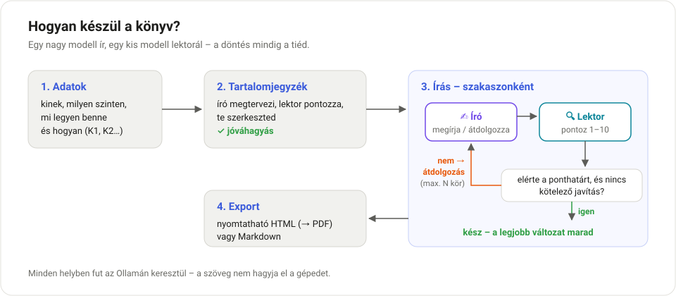
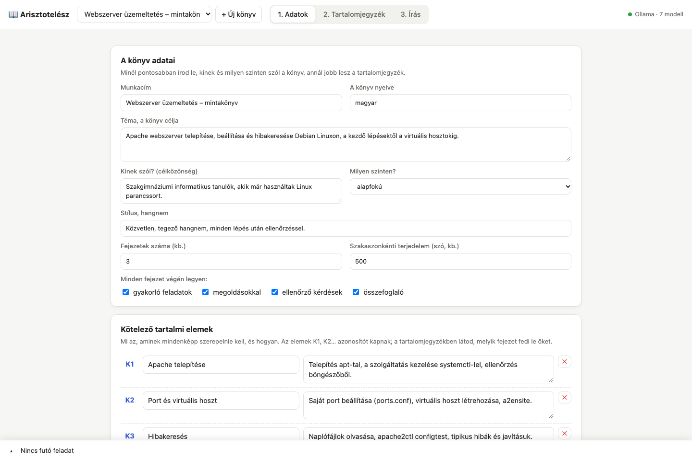
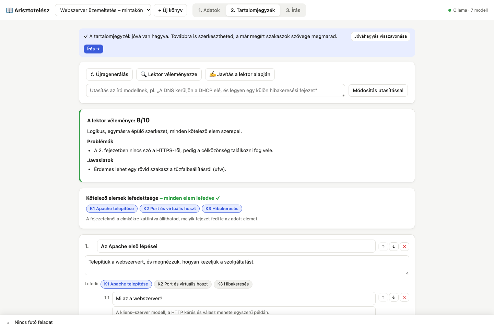
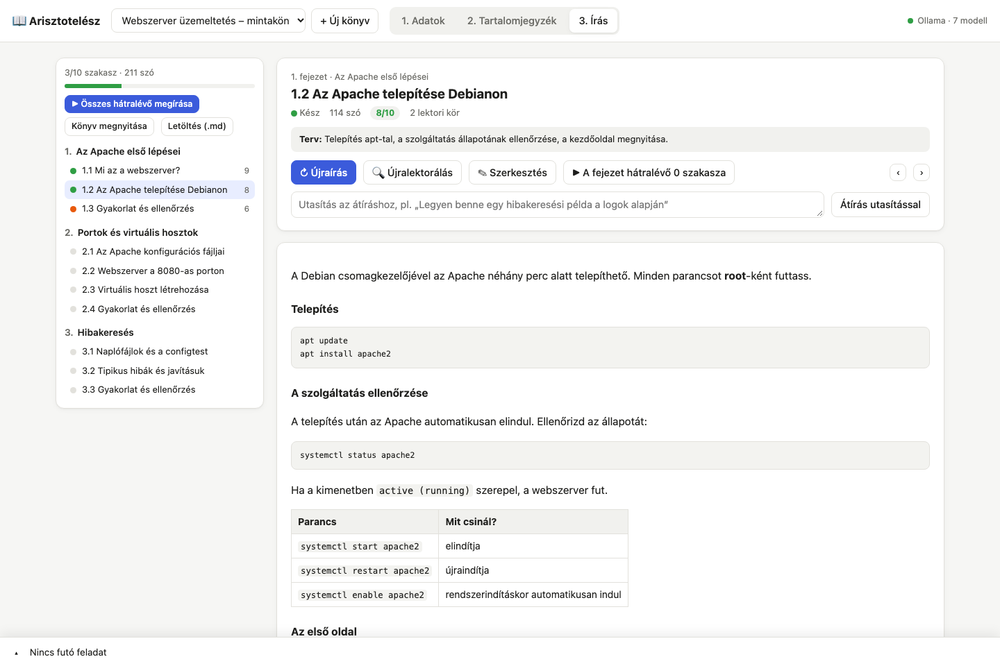

# 📖 Arisztotelész

**Könyvíró program helyi nyelvi modellekkel.** Egy nagy modell (az *író*) megírja a könyvet, egy kisebb modell (a *lektor*) pedig minden részt véleményez és pontoz. Ha egy rész nem elég jó, az író a lektor észrevételei alapján átdolgozza. Minden a saját gépeden fut az [Ollamán](https://ollama.com) keresztül, a szöveg nem kerül ki semmilyen felhőszolgáltatásba.

Leginkább **tananyagok, szakkönyvek és vizsgafelkészítő jegyzetek** írására készült: megadod, kinek szól a könyv, milyen szinten, és mi legyen benne (pl. „DHCP szerver: elmélet, beállítás Linuxon, gyakorló feladat megoldással”). Ebből tartalomjegyzék, majd fejezetről fejezetre a teljes könyv készül el.



## Képernyőképek

| 1. Adatok | 2. Tartalomjegyzék |
|---|---|
|  |  |

**3. Írás** – szakaszonként, a lektor pontszámával és véleményével:



## Mit tud?

- **Adatok megadása:** cím, téma, célközönség, szint, stílus, terjedelem, és a *kötelező tartalmi elemek* (mi legyen benne és hogyan). Az elemek K1, K2… azonosítót kapnak, így követhető, melyik fejezet fedi le őket.
- **Tartalomjegyzék:** az író megtervezi, a lektor pontozza. Utána kézzel szerkeszthető (címek, szakasztervek, sorrend, hozzáadás és törlés), vagy átdolgoztatható a lektor alapján, illetve saját utasítással. Az írás csak a **jóváhagyás** után indul.
- **Írás író–lektor körökkel:** minden szakasznál az író ír, a lektor 1–10-ig pontoz. Ha a pontszám a ponthatár alatt marad, vagy *kötelező javítás* van (pl. hibás parancs), az író átdolgozza; mindig a legjobb változat marad meg. Egy szakasz, egy fejezet vagy a teljes könyv írása is indítható.
- **Gépi ellenőrzés:** az idegen írásrendszerű karaktereket (pl. a modellből „kicsúszott” kínai vagy japán szavakat) és a csonka szöveget a program automatikusan kötelező javításnak jelöli.
- **Folytonosság:** az író látja a teljes tartalomjegyzéket, a fejezet szakaszainak tervét és a korábbi fejezetek összefoglalóját, így nem ismétel, és nem veszi előre a későbbi részeket.
- **Kézi beavatkozás:** bármelyik szakasz kézzel szerkeszthető, vagy átíratható egy utasítással (pl. „Legyen benne egy hibakeresési példa”).
- **Élő napló:** a felület alján élőben látod, amit a modellek éppen írnak.
- **Export:** nyomtatható HTML (a böngészőből PDF-be menthető) vagy Markdown.
- **Memóriakímélő mód:** kis memóriájú gépen a két modell felváltva töltődik be. Ha a GPU-memória mégis kevés, a program automatikusan kevesebb réteget tesz a GPU-ra, és megjegyzi a működő beállítást.

## Követelmények

- **[Node.js](https://nodejs.org) 20 vagy újabb.** Más csomagot nem kell telepíteni, a program függőség nélküli.
- **[Ollama](https://ollama.com)** telepítve és elindítva.
- Legalább két letöltött modell, például:

  ```bash
  ollama pull gemma4:26b    # író (nagy modell, ~19 GB)
  ollama pull qwen3.5       # lektor (kis modell, ~7 GB)
  ```

  Kisebb gépen íróként a `gemma4:12b` is jól használható. A modellek a programban bármikor átállíthatók.
- Ajánlott: 24 GB vagy több memória a 26B-s íróhoz (16 GB-on a 12B-s író).

## Telepítés

```bash
git clone git@github.com:TocsaXawer/Arisztotel-sz.git
cd Arisztotel-sz
```

## Indítás

**macOS:** dupla kattintás a `start.command` fájlon, vagy Terminálból:

```bash
./start.command
```

Az indító ellenőrzi a Node.js-t, szükség esetén elindítja az Ollamát, megnyitja a böngészőt, és amíg a program fut, nem engedi elaludni a gépet (a teljes könyv megírása órákig tarthat). Leállítás: **Ctrl+C**.

> Ha a macOS első indításkor nem engedi megnyitni: jobb klikk a fájlon → **Megnyitás**, vagy futtasd a `chmod +x start.command` parancsot.

**Linux / Windows (vagy kézzel):**

```bash
node server.js
```

Utána nyisd meg a böngészőben: **http://localhost:5577**

## Beállítás

### A programban (1. Adatok fül, „Modellek” rész)

| Beállítás | Mire való | Alapérték |
|---|---|---|
| Író (nagy) modell | ez írja a szöveget | `gemma4:26b` |
| Lektor (kis) modell | ez pontoz és véleményez | `qwen3.5:latest` |
| Modellek váltogatása | a másik modellt kiveszi a memóriából – 32 GB alatt hagyd bekapcsolva | be |
| Író / lektor gondolkodhat | a modell „thinking” módja; lassabb, néha alaposabb | ki |
| Ponthatár | ennyi pont alatt az író átdolgozza a szakaszt | 8 |
| Max. átdolgozási kör | ennyiszer próbálkozhat az író egy szakasszal | 2 |
| Író / lektor kontextus | ennyi tokent lát egyszerre a modell; hosszú, sok kötelező elemet tartalmazó könyvnél emeld 32768-ra | 16384 |
| Író / lektor GPU-rétegek | hány réteg fusson a GPU-n; üresen automatikus, memóriahiánynál a program magától csökkenti | auto |
| Író kreativitás | a temperature értéke | 0.7 |

### Indítási beállítások

A `start.command` elején, vagy környezeti változóként adhatók meg:

| Változó | Jelentés | Alapérték |
|---|---|---|
| `PORT` | a program webcíme | `5577` |
| `OLLAMA_HOST` | az Ollama címe (akár egy másik gépen) | `http://127.0.0.1:11434` |
| `PROJECTS_DIR` | hová mentse a könyveket | `./projects` |
| `OPEN_BROWSER` | indításkor megnyissa-e a böngészőt (`1` / `0`) | `1` |
| `KEEP_AWAKE` | ébren tartsa-e a Macet futás közben (`1` / `0`) | `1` |

Példa: `PORT=8080 OLLAMA_HOST=http://192.168.1.50:11434 ./start.command`

## Használat lépésről lépésre

1. **Új könyv** → töltsd ki az **Adatok** fület. A „Kötelező tartalmi elemek” résznél soronként add meg, *mi* legyen benne és *hogyan* (elmélet, beállítás lépésről lépésre, gyakorló feladat…). Minél konkrétabb (pontos parancsok, verziók, értékek), annál pontosabb lesz a könyv.
2. **Tartalomjegyzék generálása.** Nézd át a lektor véleményét és a lefedettséget (minden K-elem szerepel-e), szerkeszd, amit kell, majd **Jóváhagyás**.
3. **Írás** fül → **Összes hátralévő megírása** (vagy szakaszonként, fejezetenként). A narancs pötty azt jelzi, hogy a szakasz nem érte el a ponthatárt: ezeket érdemes átnézni, kézzel javítani vagy átíratni.
4. **Könyv megnyitása** (nyomtatható HTML → PDF) vagy **Letöltés (.md)**.

> A kis modellel végzett lektorálás nem helyettesíti az emberi átolvasást: szakmai szövegnél a végén mindig nézd át a parancsokat és a beállításokat.

## Memóriatippek (Apple Silicon)

- A `gemma4:26b` súlyai ~16 GB GPU-memóriát kérnek; 24 GB-os Macen ez épp a macOS alapértelmezett GPU-határa körül van. Ha nem fér be, a program kevesebb GPU-réteggel fut tovább (lassabban).
- Gyorsabb lesz, ha írás közben bezárod a nagy memóriafogyasztókat (böngészőfülek, játékindítók stb.).
- A GPU-határ megemelhető a következő újraindításig: `sudo sysctl iogpu.wired_limit_mb=20480`. Utána állítsd az „Író GPU-rétegek” mezőt üresre.
- Tájékoztató sebesség 24 GB-os M4-en, részleges GPU-val: egy szakasz két írási körrel ~10 perc.

## Felépítés

```
server.js          HTTP szerver és API (függőség nélkül)
start.command      indító macOS-re
lib/ollama.js      Ollama kliens (streaming, modellcsere, memóriahiány kezelése)
lib/prompts.js     az író és a lektor utasításai – itt hangolható a stílus
lib/pipeline.js    a munkafolyamat: tartalomjegyzék, író–lektor körök, összefoglalók
lib/jobs.js        háttérfeladatok és élő események (SSE)
lib/store.js       a könyvek mentése JSON fájlokba
lib/export.js      Markdown és HTML export
public/            a webes felület (HTML, CSS, JS, Markdown-megjelenítő)
projects/          a könyveid – ez nem kerül fel a gitbe
```

## Licenc

[Apache License 2.0](LICENSE)
